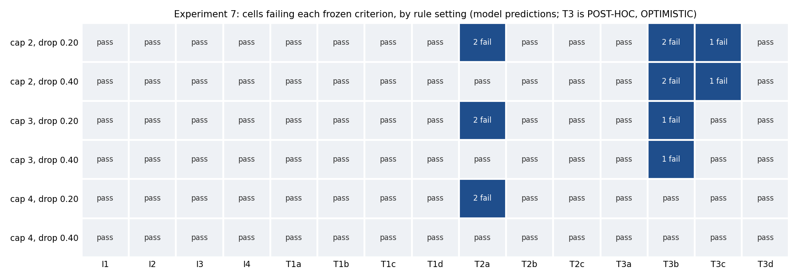

# Experiment 7 results: session cap and post-session check

**Read this first.** Everything below is a model prediction. All rule values are ASSUMED, the sensor is a synthetic experimental proxy, and the rule was designed after seeing the stuck-high result, so this is not a blind test. T3 uses patterns chosen because they empty, so it is POST-HOC and OPTIMISTIC. **Catheterisation is not modelled:** the simulated user ignores the catheter alert, so this experiment shows whether the alert arrives in time, not whether the person ends up safe. No setting here is recommended, is a clinical parameter, or becomes a new default.

Criteria were frozen first in `docs/EXPERIMENT7_CRITERIA.md`. Results are in `results/task3/`. Old result folders were not touched.

## Result

**1 of 6 rule settings passes every frozen criterion: cap 4 per 12 h run, drop 0.40.** The other 5 fail.



| Setting | Verdict | What failed |
|---|---|---|
| Cap 2, drop 0.20 | Fail | T2a, T3b, T3c |
| Cap 2, drop 0.40 | Fail | T3b, T3c |
| Cap 3, drop 0.20 | Fail | T2a, T3b |
| Cap 3, drop 0.40 | Fail | T3b |
| Cap 4, drop 0.20 | Fail | T2a |
| **Cap 4, drop 0.40** | **Pass** | Nothing, but see "Why this pass is narrow" |

**Do not quote that pass alone.** It rests on thin margins, and in one fault case the rule leaves a person worse off if they ignore the alert.

All 1,710 runs (3,767 sessions) finished with no crashes. In all 1,620 rule-on runs the invariants A2, A3 and A4 held, no session or invitation came after `CATHETER_ONLY` (I2), and the device was never silent (I3). These are facts about the simulation code, not about any device.

**Consistency check: passed.** With the rule off, seeds 42, 1 and 2 match Experiment 4 (12 runs, 144 sessions) and Experiment 3 (6 runs, 64 sessions) exactly, in all 30 run columns and 21 session columns. In T3, all 1,042 rule-on runs with no catheter alert match Experiment 3b exactly, so the rule does nothing until it acts.

## Before and after

### T1 stuck-high fault and T2 failed emptying

The rule-on figures are the same at all six settings for T1. For T2 they are the drop 0.40 settings. Leak and volume after the alert describe someone who ignores it.

| Group, pattern, strength | Rule | Sessions per run | Sessions on bladder < 100 mL, per run | Catheter alert | True volume at alert (median) | Leak, mean (max) | Max volume | Peak true pressure |
|---|---|---|---|---|---|---|---|---|
| T1, `e1.0_s0.5_5on5off`, ×1.0 | Off | 12.0 | 0 | Never | — | 0 mL | 940.4 mL | 59.4 cmH₂O |
| | On | **1.0** | 0 | 241–300 s after session | 343.4 mL | 0 mL | 940.4 mL | 59.4 cmH₂O |
| T1, `e1.0_s0.5_5on5off`, ×0.9 | Off | 12.0 | 0 | Never | — | 392.5 (430.8) mL | 491.6 mL | 59.4 cmH₂O |
| | On | **1.0** | 0 | 241–300 s after session | 343.4 mL | 416.8 (454.2) mL | 491.6 mL | 59.4 cmH₂O |
| T1, `e1.0_s0.0_5on5off`, ×1.0 | Off | 12.0 | **10.6** | Never | — | 0 mL | 367.1 mL | 53.7 cmH₂O |
| | On | **1.0** | **0** | 241–300 s after session | 7.8 mL | 0 mL | **708.6 mL** | 53.7 cmH₂O |
| T1, `e1.0_s0.0_5on5off`, ×0.9 | Off | 12.0 | **10.6** | Never | — | 0 mL | 367.1 mL | 53.7 cmH₂O |
| | On | **1.0** | **0** | 241–300 s after session | 7.8 mL | **113.4 (217.3) mL** | 491.6 mL | 53.7 cmH₂O |
| T2, declared reference, ×1.0 | Off | 10.7 | 0 | Never | — | 0 mL | 940.4 mL | 56.5 cmH₂O |
| | On | **1.0** | 0 | Within 293 s of session | 413.8 mL | 0 mL | 940.4 mL | 55.3 cmH₂O |
| T2, declared reference, ×0.9 | Off | 10.7 | 0 | Never | — | 393.7 (432.5) mL | 491.6 mL | 56.2 cmH₂O |
| | On | **1.0** | 0 | Within 293 s of session | 413.8 mL | 416.8 (454.2) mL | 491.6 mL | 55.3 cmH₂O |

**Lead time before the first leak (×0.9 only, because ×1.0 did not leak in these runs).** The earliest leak was at 6.63 h in the co-activation runs. The smallest lead was 0.51 h in T2, 1.43 h in T1 with co-activation, and 4.52 h in T1 without it.

With drop 0.20, T2 averaged 1.07 sessions per run, because one seed needed a second session (see below).

### T3 no fault

| Rule | Session-limit alerts | False alarms | Leaking runs | Max volume | Peak true pressure |
|---|---|---|---|---|---|
| Off (Experiment 3b, same 180 runs) | — | — | 0 | 477.6 mL | 53.7 cmH₂O |
| Cap 2 (per 180 runs) | 18 | 0 | **1 (136.4 mL)** | **523.9 mL** | 53.7 cmH₂O |
| Cap 3 (per 180 runs) | 1 | 0 | 0 | 477.6 mL | 53.7 cmH₂O |
| Cap 4 (per 180 runs) | 0 | 0 | 0 | 477.6 mL | 53.7 cmH₂O |

All session-limit alerts came from `e1.0_s0.0_5on5off` at 350 mL. With cap 2, 9 of 15 runs were affected at each strength, at a median of about 11 h. One of those runs then overflowed, which turned P2 from pass to fail in the ×0.9 cell (T3c). Catheterisation is not modelled, so that overflow also describes someone who ignores the alert.

No T3 session failed to empty (none voided below 10%), so T3 could only test false alarms. All 2,166 finished checks passed. Another 14 sessions started within 3 minutes of the end of the run, so their checks never finished.

## Why this pass is narrow

**The check separates failed from emptied sessions by a gap of about 0.23, measured on a best-case sensor.**

| Sessions | Drop in the estimate | Note |
|---|---|---|
| Failed, nothing voided (T2, 15 seeds) | −0.227 to **0.262** | Pure sensor noise |
| Partial, 10–50% voided (T3) | **0.417** to 0.569 | Not judged. Only 0.017 above the 0.40 line |
| Emptied, ≥ 50% voided (T3) | **0.493** and up | Median 0.989 |

- **Drop 0.20 failed on one seed.** In seed 11, nothing was voided, but the estimate fell from 413 to 305 mL, a drop of 0.262. The true volume was 341 mL, so the starting estimate was 72 mL too high. A second session was needed before the fault alert came, 3,293 s after the first failed session. That one event is what fails T2a in all three drop 0.20 settings, at both strengths. It is one seed, not six independent failures.
- **The likely reason is that alerts pick out high readings.** The starting estimate was above the true volume in 12 of 15 T2 runs, and a high starting estimate tends to fall on its own. This is an interpretation of those 15 runs, not a tested finding.
- **Cap 4 has no spare room.** One of the 180 cap 4 T3 runs used all 4 sessions (`e1.0_s0.0_5on5off`, 350 mL, ×0.9). The extra sessions come from ceiling-55 noise stops (E62), not from faults.
- **Sample size.** 15 clean runs per cell give a lower bound of about 82%, not 95% (E68).
- **One sensor only.** Everything used the anchor sensor (11.17%). A noisier sensor would narrow the gap, and this was not tested.

## What the rule did and did not do

**What it did**
- It caught the stuck-high fault in all 360 rule-on runs, after exactly 1 session, within 300 s. Sessions per run fell from 12 to 1.
- It removed all 10.6 sessions per run on a bladder below 100 mL in the stuck-high case with a pattern that empties.
- It caught failed emptying in all 180 rule-on runs, before the first leak.
- Reaching `CATHETER_ONLY` always came with an alert, repeated every 30 minutes until the end of the run.

**What it did not do**
- **It can make things worse if the alert is ignored.** With a stuck sensor and a pattern that empties, the 12 unnecessary sessions happened to keep the bladder emptied. Without them, maximum volume rose from 367.1 to 708.6 mL at ×1.0, and all 15 ×0.9 runs leaked (up to 217.3 mL, against none). The rule moves the risk onto the catheter alert being acted on, which is not modelled.
- **It does not reduce the worst pressure.** The peak of 59.4 cmH₂O, 4.4 above the ceiling, is in the first session, which still happens. It is the same with the rule on or off.
- **It does not reduce leak or volume in the co-activation cases.** Those patterns were not emptying anyway. Mean leak at ×0.9 was slightly higher with the rule on (T1 416.8 against 392.5 mL). The cause was not traced.
- **The session cap caught no fault.** All 540 catheter alerts in fault runs came from the check. All 38 session-limit alerts came from no-fault runs, so in this experiment the cap only ever interrupted normal use. It may still act as a backstop for faults the check misses, but that was not tested.

## What the sweep did not exercise

- **The timeout path never fired.** No run had a sensor dropout, so that path was covered only by unit tests.
- **Presses during `CATHETER_ONLY` never happened.** The simulated user only presses after a vibration, and catheter alerts do not vibrate. Unit tests cover this too.
- **T2b was empty at ×1.0.** Those runs never leaked, so the alert was "before the first leak" automatically.
- **T1d was easy.** Every T1 run had only 1 session, so the cap was never reached in the fault group.

## Declared limitations

All limitations in `docs/EXPERIMENT7_CRITERIA.md` stand: catheterisation not modelled; the first stimulation still happens; stuck-low and misalignment not caught or tested; dead pressure channel with stuck-high, the ceiling-40 trap, delayed users and continuous patterns not tested; no reset path; a long sensor dropout can latch the device for the rest of the run; session caps are per 12 h run, not per day.

## Reproduce

```bash
python experiments/task3_experiment7.py
```

```bash
python experiments/task3_analysis.py
```

The sweep took 3.8 h on 12 cores, not the 2.7 h estimated (E74). `python experiments/task3_experiment7.py --recheck` repeats only the consistency check.
